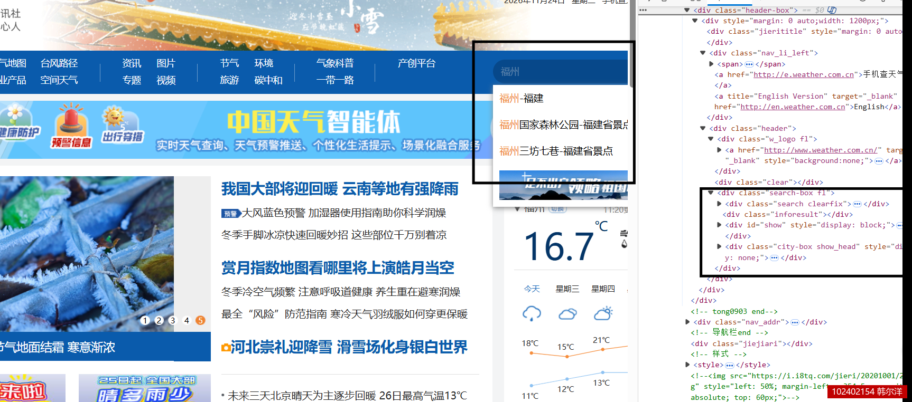
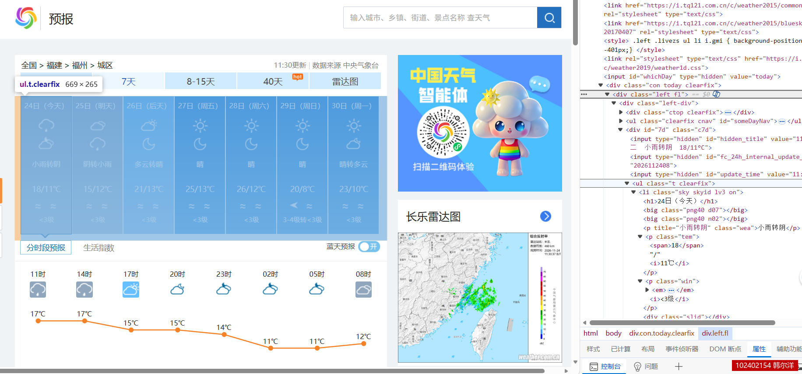
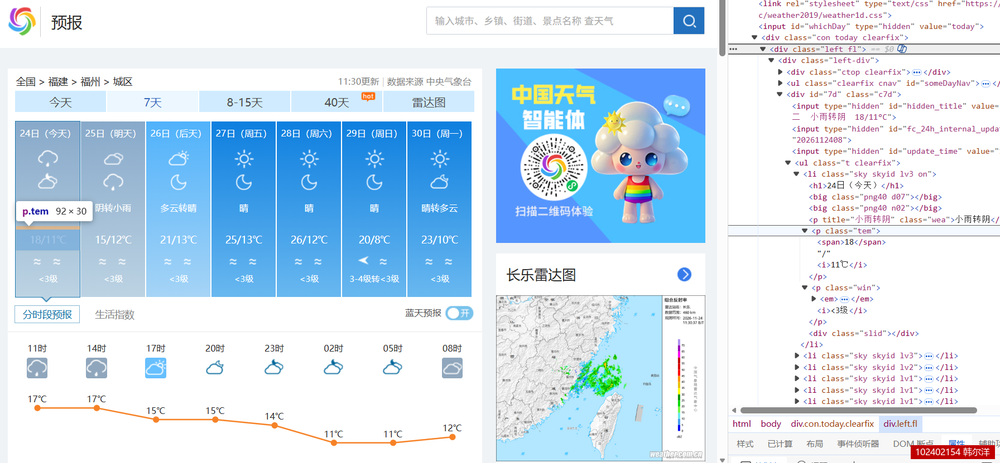
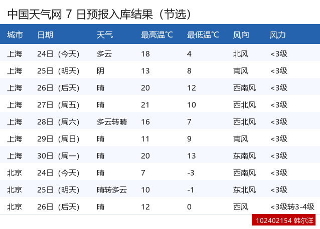
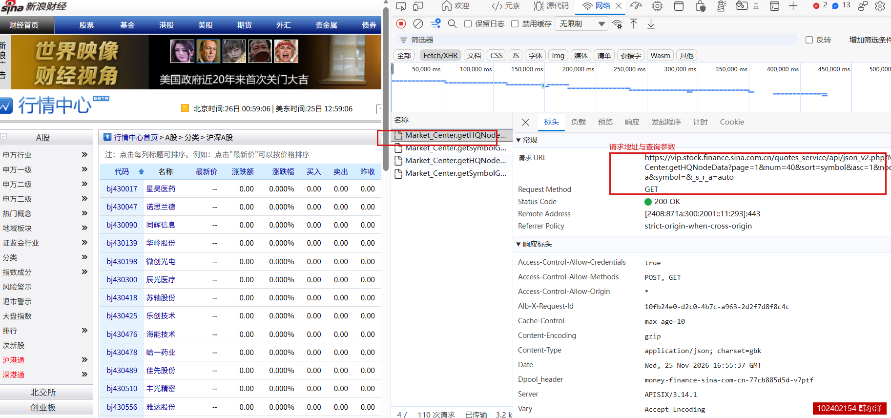
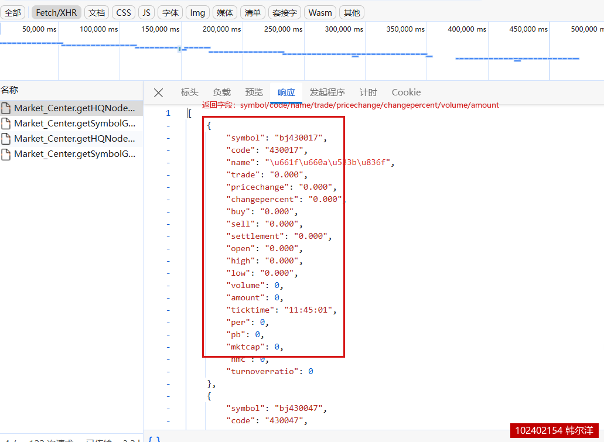
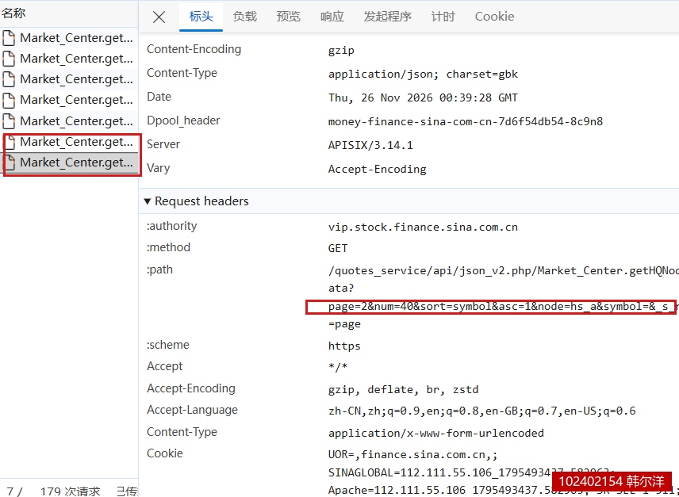
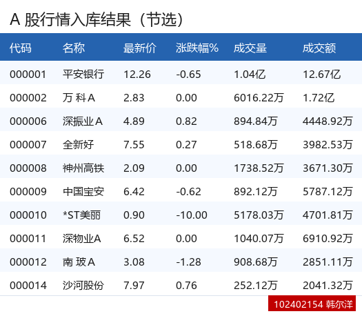
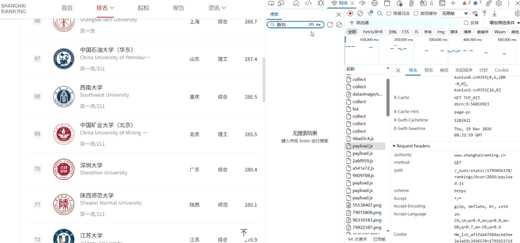
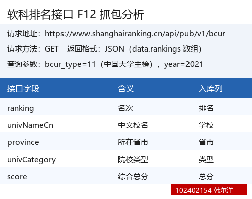

# 《数据采集与融合技术》第二次作业博客

- 姓名：韩尔洋
- 学号：102402154
- 专业：数据科学与大数据技术
- 运行环境：Python 3.13 / requests / beautifulsoup4 / sqlite3（标准库）

> 说明：本次作业三个爬虫任务统一使用 Python 编写，数据落地到内置的 SQLite 数据库（零配置、可直接运行）；代码中同时预留了切换 MySQL（pymysql）的连接注释，如需改用 MySQL 取消注释并填写连接信息即可。

| 作业 | 采集内容 | 本次入库结果 | 数据库 |
| --- | --- | --- | --- |
| ① 天气预报 | 北京、上海、福州、广州、成都 5 个城市的 7 日天气 | 35 条（5 城 × 7 天） | `作业1/weather.db` |
| ② 股票信息 | 沪深 A 股行情：代码、名称、最新价、涨跌幅、成交量、成交额 | 5580 只 | `作业2/stock.db` |
| ③ 大学排名 | 软科 2021 中国大学主榜全部院校：排名、学校、省市、类型、总分 | 582 所（含并列名次） | `作业3/rank_2021.db` |

---

## 一、天气与股票：定向爬取并入库（作业①②）

### （一）实现过程：代码与运行结果

#### 作业① 中国天气网 7 日天气预报

**实现思路：**

1. 选定 5 个城市：北京、上海、福州、广州、成都，每个城市对应中国天气网的城市编码；
2. 通过 `requests` 请求对应城市的 7 日预报页面（`http://www.weather.com.cn/weather/{编码}.shtml`）；
3. 页面中 7 天预报位于 `<ul class="t clearfix">` 下的 7 个 `<li>` 标签内，使用 BeautifulSoup 解析出日期、天气现象、最高/最低气温、风向与风力；
4. 解析结果写入 SQLite 数据库表 `weather_forecast`，重复运行时先清除该城市旧数据再写入，避免重复。

**完整代码（仓库路径：`作业1/1.py`）：**

```python
# -*- coding: utf-8 -*-
"""
作业1：中国天气网 3~5 个城市 7 日天气预报爬取并入库
来源站点：http://www.weather.com.cn
方法：requests 请求 7 日预报页面 -> BeautifulSoup 解析 HTML -> 存入 SQLite 数据库
作者：102402154 韩尔洋
运行环境：Python 3.13 / requests / beautifulsoup4 / sqlite3(标准库)
运行方式：python 1.py
"""

import os
import time
import sqlite3
from datetime import datetime

import requests
from bs4 import BeautifulSoup

# ----------------------------------------------------------------------------
# 1. 基础配置
# ----------------------------------------------------------------------------
# 待查询城市：城市名 -> 中国天气网城市编码（编码可在 weather.com.cn 对应城市页面 URL 中获得）
CITY_CODES = {
    "北京": "101010100",
    "上海": "101020100",
    "福州": "101230101",
    "广州": "101280101",
    "成都": "101270101",
}

BASE_URL = "http://www.weather.com.cn/weather/{code}.shtml"

HEADERS = {
    "User-Agent": ("Mozilla/5.0 (Windows NT 10.0; Win64; x64) "
                   "AppleWebKit/537.36 (KHTML, like Gecko) Chrome/120.0 Safari/537.36")
}

# 数据库文件放在本脚本所在目录下
DB_PATH = os.path.join(os.path.dirname(os.path.abspath(__file__)), "weather.db")

# 若需要改用 MySQL，可使用 pymysql 按如下方式连接（此处仅作预留说明）：
# import pymysql
# conn = pymysql.connect(host="127.0.0.1", port=3306, user="root",
#                        password="你的密码", database="weather", charset="utf8mb4")


def fetch_html(code: str) -> str:
    """根据城市编码请求 7 日预报页面，返回页面 HTML 文本。"""
    url = BASE_URL.format(code=code)
    resp = requests.get(url, headers=HEADERS, timeout=15)
    resp.encoding = "utf-8"  # 天气网页面为 UTF-8 编码
    resp.raise_for_status()
    return resp.text


def parse_forecast(city: str, code: str, html: str) -> list[dict]:
    """解析 7 日预报列表，返回结构化字典列表。

    页面结构：<ul class="t clearfix"> 下有 7 个 <li>，分别对应今天起 7 天：
        <h1>24日（今天）</h1>            -> 日期
        <p class="wea">小雨转阴</p>       -> 天气现象
        <p class="tem"><span>18</span>/<i>11℃</i></p> -> 高/低温
        <p class="win"><em><span title="无持续风向"/></em><i><3级</i></p> -> 风
    """
    soup = BeautifulSoup(html, "html.parser")
    ul = soup.find("ul", class_="t clearfix")
    forecasts: list[dict] = []

    if ul is None:
        print(f"[警告] {city} 页面未找到 7 日预报列表")
        return forecasts

    for li in ul.find_all("li"):
        # 日期文本，如“24日（今天）”
        date_tag = li.find("h1")
        date_text = date_tag.get_text(strip=True) if date_tag else ""

        # 天气现象，优先取 title 属性，回退到标签文本
        wea_tag = li.find("p", class_="wea")
        if wea_tag is not None:
            weather = wea_tag.get("title") or wea_tag.get_text(strip=True)
        else:
            weather = ""

        # 温度：<span> 最高温，<i> 最低温（末尾带 ℃）
        tem_tag = li.find("p", class_="tem")
        temp_high, temp_low = "", ""
        if tem_tag is not None:
            span = tem_tag.find("span")
            i_tag = tem_tag.find("i")
            temp_high = span.get_text(strip=True) if span else ""
            temp_low = i_tag.get_text(strip=True).replace("℃", "") if i_tag else ""

        # 风向与风力
        win_tag = li.find("p", class_="win")
        wind_dir, wind_level = "", ""
        if win_tag is not None:
            em = win_tag.find("em")
            if em is not None:
                first_span = em.find("span")
                if first_span is not None:
                    wind_dir = first_span.get("title", "")
            level = win_tag.find("i")
            if level is not None:
                wind_level = level.get_text(strip=True)

        forecasts.append({
            "city": city,
            "city_code": code,
            "date_text": date_text,
            "weather": weather,
            "temp_high": temp_high,
            "temp_low": temp_low,
            "wind_dir": wind_dir,
            "wind_level": wind_level,
        })

    return forecasts


def init_db(conn: sqlite3.Connection) -> None:
    """创建天气预报表（不存在则创建）。"""
    conn.execute(
        """
        CREATE TABLE IF NOT EXISTS weather_forecast (
            id          INTEGER PRIMARY KEY AUTOINCREMENT,
            city        TEXT NOT NULL,
            city_code   TEXT NOT NULL,
            date_text   TEXT NOT NULL,
            weather     TEXT,
            temp_high   TEXT,
            temp_low    TEXT,
            wind_dir    TEXT,
            wind_level  TEXT,
            crawl_time  TEXT
        )
        """
    )
    conn.commit()


def save_to_db(conn: sqlite3.Connection, rows: list[dict]) -> None:
    """将一批预报记录写入数据库，先清空该城市旧数据再写入，避免重复。"""
    city = rows[0]["city"]
    crawl_time = datetime.now().strftime("%Y-%m-%d %H:%M:%S")
    conn.execute("DELETE FROM weather_forecast WHERE city = ?", (city,))
    conn.executemany(
        """
        INSERT INTO weather_forecast
            (city, city_code, date_text, weather, temp_high, temp_low,
             wind_dir, wind_level, crawl_time)
        VALUES (?, ?, ?, ?, ?, ?, ?, ?, ?)
        """,
        [
            (r["city"], r["city_code"], r["date_text"], r["weather"],
             r["temp_high"], r["temp_low"], r["wind_dir"], r["wind_level"], crawl_time)
            for r in rows
        ],
    )
    conn.commit()


def main() -> None:
    conn = sqlite3.connect(DB_PATH)
    init_db(conn)

    total = 0
    for city, code in CITY_CODES.items():
        try:
            html = fetch_html(code)
            rows = parse_forecast(city, code, html)
            if rows:
                save_to_db(conn, rows)
                total += len(rows)
                print(f"[完成] {city}({code}) 入库 {len(rows)} 条 7 日预报")
            time.sleep(1)  # 礼貌延时，避免对站点造成压力
        except requests.RequestException as e:
            print(f"[错误] {city} 请求失败：{e}")

    print(f"\n本次共入库 {total} 条预报，数据库文件：{DB_PATH}")

    # 入库核对：统计总条数、各城市条数与首条记录，便于与网页逐项比对
    count = conn.execute("SELECT COUNT(*) FROM weather_forecast").fetchone()[0]
    per_city = dict(conn.execute("SELECT city, COUNT(*) FROM weather_forecast GROUP BY city").fetchall())
    first = conn.execute(
        "SELECT city, date_text, weather, temp_high, temp_low FROM weather_forecast ORDER BY id LIMIT 1"
    ).fetchone()
    print(f"[核对] 数据库共 {count} 条，各城市条数：{per_city}")
    print(f"[核对] 首条记录：{first}")
    conn.close()


if __name__ == "__main__":
    main()
```

**运行结果：** 5 个城市 × 7 天，共入库 **35 条** 7 日预报，保存于 `作业1/weather.db`。经核对，每个城市各 7 条，与网页 7 日列表条数一致；首条记录为北京 24 日（今天）的天气与气温。

**页面分析（F12）：** 在开发者工具 Elements 面板中定位七日预报区域 `<ul class="t clearfix">`，列表内每个 `<li>` 对应一天：`h1` 为日期、`p.wea` 为天气现象、`p.tem` 内含最高/最低温、`p.win` 为风向与风力。









---

#### 作业② A 股股票行情信息爬取

**实现思路：**

1. 在浏览器中按 F12 打开开发者工具，切换到 Network（网络）面板，抓取股票列表加载时使用的请求 URL 与返回结构；
2. 作业候选站点包含新浪财经行情中心。经抓包分析，行情数据由 JSON 接口返回，使用 `requests` 分页请求、`json` 解析；
3. 接口通过查询参数控制分页与范围，返回 JSON 数组；参数与字段含义如下两表所示；
4. 逐页翻页直至取完全部 A 股，批量写入 SQLite 表 `stock`，代码为主键，重复时替换为最新行情。

**请求参数对照：**

| 参数 | 含义 |
| --- | --- |
| `page` | 页码，从 1 开始 |
| `num` | 每页条数 |
| `sort` | 排序字段（`symbol` 按股票代码排序） |
| `asc` | 升降序（1 为升序） |
| `node` | 行情节点（`hs_a` 为沪深 A 股） |

**返回字段对照：**

| 字段 | 含义 |
| --- | --- |
| `code` | 纯股票代码（标识符，按文本保存以保留前导零） |
| `symbol` | 带市场前缀的代码（如 sh600000、sz000001） |
| `name` | 股票名称 |
| `trade` | 最新价 |
| `pricechange` | 涨跌额 |
| `changepercent` | 涨跌幅（%） |
| `volume` | 成交量（股） |
| `amount` | 成交额（元） |

> 备注：东方财富行情节点在本机网络环境下连接被远端断开，因此改用作业候选中给出的新浪财经行情接口，二者均为 JSON 定向爬取思路。

**完整代码（仓库路径：`作业2/2.py`）：**

```python
# -*- coding: utf-8 -*-
"""
作业2：使用 requests + json 定向爬取 A 股股票行情信息并入库
来源站点：新浪财经-行情中心 https://finance.sina.com.cn/stock/
接口说明：浏览器 F12 抓包可得行情列表 JSON 接口（Market_Center.getHQNodeData），
    node=hs_a 表示沪深 A 股；返回数组，主要字段：
        symbol 带市场前缀的代码(如 sh600000) / code 纯代码 / name 名称 /
        trade 最新价 / pricechange 涨跌额 / changepercent 涨跌幅(%) /
        volume 成交量(股) / amount 成交额(元)
方法：requests 分页请求 JSON -> json 解析 -> 存入 SQLite 数据库
作者：102402154 韩尔洋
运行环境：Python 3.13 / requests / sqlite3(标准库)
运行方式：python 2.py
"""

import os
import time
import sqlite3
from datetime import datetime

import requests

# ----------------------------------------------------------------------------
# 1. 基础配置
# ----------------------------------------------------------------------------
# 行情列表接口
LIST_URL = ("https://vip.stock.finance.sina.com.cn/quotes_service/api/"
            "json_v2.php/Market_Center.getHQNodeData")
# 股票总数接口
COUNT_URL = ("https://vip.stock.finance.sina.com.cn/quotes_service/api/"
             "json_v2.php/Market_Center.getHQNodeStockCount")

NODE = "hs_a"      # 沪深 A 股节点
PAGE_SIZE = 100    # 每页条数

HEADERS = {
    "User-Agent": ("Mozilla/5.0 (Windows NT 10.0; Win64; x64) "
                   "AppleWebKit/537.36 (KHTML, like Gecko) Chrome/120.0 Safari/537.36"),
    "Referer": "https://finance.sina.com.cn/stock/",
}

DB_PATH = os.path.join(os.path.dirname(os.path.abspath(__file__)), "stock.db")

# 预留 MySQL 连接方式（pymysql）：
# import pymysql
# conn = pymysql.connect(host="127.0.0.1", port=3306, user="root",
#                        password="你的密码", database="stock", charset="utf8mb4")


def to_float(value):
    """把接口返回值安全转换为浮点数； '-'、None 等非法值返回 None。"""
    if value in ("-", "", None):
        return None
    try:
        return float(value)
    except (TypeError, ValueError):
        return None


def fetch_total() -> int:
    """请求 A 股股票总数；失败时返回 0（仅用于进度参考，不影响翻页）。"""
    try:
        r = requests.get(COUNT_URL, params={"node": NODE}, headers=HEADERS, timeout=15)
        r.raise_for_status()
        return int(r.text.strip().strip('"'))
    except (requests.RequestException, ValueError):
        return 0


def fetch_page(page: int) -> list[dict]:
    """请求一页行情数据，返回原始字典列表。"""
    params = {
        "page": page,
        "num": PAGE_SIZE,
        "sort": "symbol",
        "asc": 1,
        "node": NODE,
        "symbol": "",
        "_s_r_a": "init",
    }
    resp = requests.get(LIST_URL, params=params, headers=HEADERS, timeout=15)
    resp.raise_for_status()
    # 接口直接返回 JSON 数组
    return resp.json() or []


def parse_stocks(items: list[dict]) -> list[dict]:
    """将原始记录映射为结构化字典列表。"""
    stocks: list[dict] = []
    for item in items:
        stocks.append({
            "code": item.get("code", ""),
            "symbol": item.get("symbol", ""),
            "name": item.get("name", ""),
            "price": to_float(item.get("trade")),
            "change_amount": to_float(item.get("pricechange")),
            "change_pct": to_float(item.get("changepercent")),
            "volume": to_float(item.get("volume")),
            "amount": to_float(item.get("amount")),
        })
    return stocks


def init_db(conn: sqlite3.Connection) -> None:
    """创建股票行情表（不存在则创建）。"""
    conn.execute(
        """
        CREATE TABLE IF NOT EXISTS stock (
            code           TEXT PRIMARY KEY,
            symbol         TEXT,
            name           TEXT,
            price          REAL,
            change_amount  REAL,
            change_pct     REAL,
            volume         REAL,
            amount         REAL,
            crawl_time     TEXT
        )
        """
    )
    conn.commit()


def save_to_db(conn: sqlite3.Connection, stocks: list[dict]) -> None:
    """批量写入股票记录；代码为主键，重复时替换为最新行情。"""
    crawl_time = datetime.now().strftime("%Y-%m-%d %H:%M:%S")
    conn.executemany(
        """
        INSERT OR REPLACE INTO stock
            (code, symbol, name, price, change_amount, change_pct, volume, amount, crawl_time)
        VALUES (?, ?, ?, ?, ?, ?, ?, ?, ?)
        """,
        [
            (s["code"], s["symbol"], s["name"], s["price"], s["change_amount"],
             s["change_pct"], s["volume"], s["amount"], crawl_time)
            for s in stocks
        ],
    )
    conn.commit()


def main() -> None:
    conn = sqlite3.connect(DB_PATH)
    init_db(conn)

    total = fetch_total()
    if total:
        print(f"接口返回 A 股股票总数：{total}")

    all_stocks: list[dict] = []
    page = 1

    while True:
        items = fetch_page(page)
        if not items:
            break
        stocks = parse_stocks(items)
        all_stocks.extend(stocks)

        # 已取满总数或本页不足一页时结束翻页
        if total and len(all_stocks) >= total:
            break
        if len(items) < PAGE_SIZE:
            break
        page += 1
        time.sleep(0.5)  # 分页礼貌延时

    save_to_db(conn, all_stocks)
    print(f"本次共入库 {len(all_stocks)} 只股票行情，数据库文件：{DB_PATH}")

    # 入库核对：统计总条数与首条记录，确认与接口返回总数一致
    count = conn.execute("SELECT COUNT(*) FROM stock").fetchone()[0]
    first = conn.execute(
        "SELECT code, name, price, change_pct FROM stock ORDER BY code LIMIT 1"
    ).fetchone()
    print(f"[核对] 数据库共 {count} 只股票，首条记录：{first}")
    conn.close()


if __name__ == "__main__":
    main()
```

**运行结果：** 共入库 **5580 只** A 股行情，保存于 `作业2/stock.db`，入库条数与接口返回的股票总数一致；首条记录为代码最小的一只股票。

**接口分析（F12）：** 在 Network 面板的 Fetch/XHR 请求中定位行情列表请求 `Market_Center.getHQNodeData`，标头中可见查询参数 `page`、`num`、`sort`、`asc`、`node=hs_a`；Response 为 JSON 数组，按返回字段表取值。翻到第 2 页时 `page` 由 1 变为 2，对比如下。









### （二）作业心得

通过作业①②，我走完了“页面/接口分析 → 发起请求 → 解析数据 → 入库存储”的完整爬虫流程。

- **解析方式的区别：** 天气网的数据直接渲染在 HTML 页面中，需要借助 BeautifulSoup 按标签层级和 class 名定位；股票接口返回的是 JSON 数组，可以直接按字段名取值，解析更直接。这让我体会到，拿到一个站点后应先判断它是“服务端直出 HTML”还是“前端异步加载 JSON”，再选择对应的解析手段。
- **参数与字段意识：** 抓包时重点看请求 URL、查询参数和返回值结构；不同参数可取到不同数值，字段也可以按需要增删。接口里的数值可能是 `-`、空串等异常形式，入库前需要统一做类型容错，避免转换报错。
- **分页与礼貌访问：** 股票数据需要翻页获取，程序通过“取满总数 / 本页不足一页”两个条件判断结束翻页，并在每页之间加入延时，既保证抓全，也避免给站点造成压力。
- **字段类型与缺失值：** 股票代码虽然由数字组成，但它是标识符，应当按文本（TEXT）保存，才能保留前导零；价格、涨跌幅等字段转换为数值，接口缺失的数值保存为 NULL，而不是补 0。天气的最高温在个别日期也可能缺失，程序保留空值，不自行臆造一个温度。
- **结果核对不能只看“没报错”：** 跑完程序后要回到数据库逐项核对：天气按城市检查是否各有 7 条、天气和温度是否与网页对应；股票核对入库总数与接口返回总数是否一致；同时检查字段有没有取错列。这样既能发现漏采，也能查出字段错位。
- **请求头与来源校验：** 部分站点会校验请求来源，缺少 Referer 时可能返回 403 或断开连接，因此请求行情、排名接口时都带上了对应页面的 Referer；排查请求问题时要同时看状态码和响应内容，而不能只凭“浏览器能打开”就认定程序请求一定相同。
- **数据落地：** 三张表都记录了抓取时间，方便核对数据时效；重复运行时按主键替换或先清后插，保证库里不出现重复记录。

---

## 二、软科 2021 中国大学主榜爬取（作业③）

### （一）实现过程：接口分析、代码与结果

**F12 调试分析过程：**

1. 打开榜单页面 `https://www.shanghairanking.cn/rankings/bcur/2021`，按 F12 进入开发者工具，切换到 Network（网络）面板，过滤 Fetch/XHR 请求；
2. 刷新页面，观察列表加载时发出的请求，定位到排名数据接口；
3. 在 Response（响应）中确认返回的是 JSON 结构，`data.rankings` 为院校数组，并逐字段对照页面表格确认字段含义；
4. 分析请求参数：`bcur_type=11` 表示中国大学主榜，`year=2021` 表示榜单年份。

> 按作业要求，浏览器中 F12 调试分析的全过程录制为 GIF，已放置于 `作业3/images/F12抓包分析.gif`，文件名与下方引用一致。



接口与字段对应关系如下（静态分析示意图）：



**接口信息：**

- 请求地址：`https://www.shanghairanking.cn/api/pub/v1/bcur`
- 请求方法：GET
- 查询参数：`bcur_type=11`（中国大学主榜）、`year=2021`
- 返回字段：`ranking` 排名、`univNameCn` 学校、`province` 省市、`univCategory` 类型、`score` 总分

**完整代码（仓库路径：`作业3/3.py`）：**

```python
# -*- coding: utf-8 -*-
"""
作业3：爬取软科 2021 中国大学主榜全部院校信息并入库
来源站点：https://www.shanghairanking.cn/rankings/bcur/2021
接口说明：浏览器 F12 分析页面发包，可得排名数据 JSON 接口：
    /api/pub/v1/bcur?bcur_type=11&year=2021
    返回 data.rankings 数组，主要字段：
        ranking 排名 / univNameCn 学校名称 / province 省市 /
        univCategory 院校类型 / score 总分
方法：requests 请求 JSON -> json 解析 -> 存入 SQLite 数据库
作者：102402154 韩尔洋
运行环境：Python 3.13 / requests / sqlite3(标准库)
运行方式：python 3.py
"""

import os
import sqlite3
from datetime import datetime

import requests

# ----------------------------------------------------------------------------
# 1. 基础配置
# ----------------------------------------------------------------------------
API_URL = "https://www.shanghairanking.cn/api/pub/v1/bcur"

HEADERS = {
    "User-Agent": ("Mozilla/5.0 (Windows NT 10.0; Win64; x64) "
                   "AppleWebKit/537.36 (KHTML, like Gecko) Chrome/120.0 Safari/537.36"),
    "Referer": "https://www.shanghairanking.cn/rankings/bcur/2021",
}

# 查询参数：bcur_type=11 为中国大学主榜，year=2021 为榜单年份
PARAMS = {"bcur_type": 11, "year": 2021}

DB_PATH = os.path.join(os.path.dirname(os.path.abspath(__file__)), "rank_2021.db")

# 预留 MySQL 连接方式（pymysql）：
# import pymysql
# conn = pymysql.connect(host="127.0.0.1", port=3306, user="root",
#                        password="你的密码", database="rank", charset="utf8mb4")


def to_float(value):
    """把接口返回值安全转换为浮点数；空字符串、None 等非法值返回 None。"""
    if value in ("", "-", None):
        return None
    try:
        return float(value)
    except (TypeError, ValueError):
        return None


def fetch_rankings() -> list[dict]:
    """请求排名接口，解析并返回结构化院校列表。"""
    resp = requests.get(API_URL, params=PARAMS, headers=HEADERS, timeout=15)
    resp.raise_for_status()
    payload = resp.json()

    # 接口状态码 code=200 表示成功
    if payload.get("code") != 200:
        raise ValueError(f"接口返回异常：{payload.get('msg')}")

    rankings = (payload.get("data") or {}).get("rankings") or []
    result: list[dict] = []
    for item in rankings:
        result.append({
            "ranking": item.get("ranking"),
            "name": item.get("univNameCn", ""),
            "province": item.get("province", ""),
            "category": item.get("univCategory", ""),
            "score": to_float(item.get("score")),
        })
    return result


def init_db(conn: sqlite3.Connection) -> None:
    """创建大学排名表（不存在则创建）。

    说明：软科主榜存在并列名次（同一排名有多所院校），因此排名不作为唯一主键，
    改用自增 id 作主键，ranking 仅作为普通列，保证全部院校都能入库。
    """
    conn.execute(
        """
        CREATE TABLE IF NOT EXISTS university_rank (
            id         INTEGER PRIMARY KEY AUTOINCREMENT,
            ranking    INTEGER,
            name       TEXT NOT NULL,
            province   TEXT,
            category   TEXT,
            score      REAL,
            crawl_time TEXT
        )
        """
    )
    conn.commit()


def save_to_db(conn: sqlite3.Connection, rows: list[dict]) -> None:
    """批量写入排名记录；先清空旧数据再写入，避免重复运行产生叠加。"""
    crawl_time = datetime.now().strftime("%Y-%m-%d %H:%M:%S")
    conn.execute("DELETE FROM university_rank")
    conn.executemany(
        """
        INSERT INTO university_rank
            (ranking, name, province, category, score, crawl_time)
        VALUES (?, ?, ?, ?, ?, ?)
        """,
        [
            (r["ranking"], r["name"], r["province"], r["category"], r["score"], crawl_time)
            for r in rows
        ],
    )
    conn.commit()


def main() -> None:
    conn = sqlite3.connect(DB_PATH)
    init_db(conn)

    rows = fetch_rankings()
    save_to_db(conn, rows)

    print(f"本次共入库 {len(rows)} 所院校信息，数据库文件：{DB_PATH}")

    # 入库核对：总条数、含并列名次的名次个数、首条记录，与网页标注总数比对
    count = conn.execute("SELECT COUNT(*) FROM university_rank").fetchone()[0]
    dup = conn.execute(
        "SELECT COUNT(*) FROM (SELECT ranking FROM university_rank GROUP BY ranking HAVING COUNT(*) > 1)"
    ).fetchone()[0]
    first = conn.execute(
        "SELECT ranking, name, province, category, score FROM university_rank ORDER BY ranking LIMIT 1"
    ).fetchone()
    print(f"[核对] 数据库共 {count} 所院校，其中并列名次 {dup} 个；首条记录：{first}")
    conn.close()


if __name__ == "__main__":
    main()
```

**运行结果：** 共入库 **582 所** 院校信息（含并列名次），保存于 `作业3/rank_2021.db`，与网页标注总数一致；其中并列名次 62 个，首条记录为排名 1、清华大学、北京、综合、总分 969.2，与页面表格一致。


### （二）作业心得

作业③让我重点练习了“从页面发包中定位数据接口”的能力，也暴露并解决了一个数据库设计上的细节问题。

- **先分析发包再写代码：** 榜单页面的表格由前端异步加载，HTML 源码里只包含前一部分院校。通过 F12 的 Network 面板筛选 XHR/Fetch 请求，才能找到真正返回全量数据的 JSON 接口；相比硬解析 HTML，直接调用数据接口更稳定，也更容易取到全部记录。
- **字段对照要细致：** 接口字段多为英文缩写（如 `univNameCn`、`univCategory`），需要逐条和页面表格对照，确认哪个字段对应学校、省市、类型和总分，避免入库时串列。
- **并列名次的主键设计：** 软科主榜存在并列排名（同一名次有多所学校）。最初把 `ranking` 设为主键时，并列院校会被 `INSERT OR REPLACE` 覆盖，导致入库条数少于实际；改为自增 `id` 主键、`ranking` 仅作普通列后，全部 582 所院校才完整保留。这让我意识到，设计表结构时必须先观察数据是否存在重复键，再决定主键策略。
- **全量与容错：** 接口一次性返回全量数组，程序对总分等可能为空的字段做了浮点容错，保证异常值不会中断整批入库。
- **完整性核对：** 入库后把解析出的 582 所院校与网页标注总数比对，检查学校名称是否重复、年份是否为 2021，并确认首条记录为清华大学、总分 969.2，与页面表格一致。记录数量、关键字段和存储结果分别核对，比只展示前几所学校更能说明采集是否完整。

---

## 附：GitHub 仓库链接

- 仓库主页：https://github.com/haneryang/data-collection-fusion-hw2
- 作业①（天气）：https://github.com/haneryang/data-collection-fusion-hw2/tree/main/作业1
- 作业②（股票）：https://github.com/haneryang/data-collection-fusion-hw2/tree/main/作业2
- 作业③（大学排名）：https://github.com/haneryang/data-collection-fusion-hw2/tree/main/作业3
